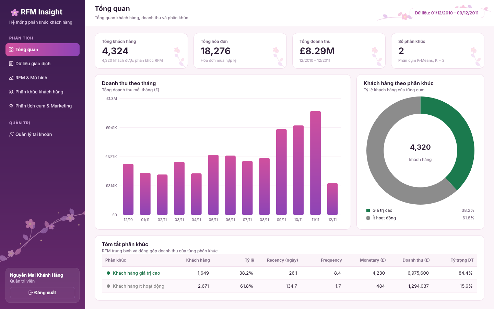

# RFM Insight – Phân khúc khách hàng bằng RFM và K-Means (Nhóm 09)

Ứng dụng PyQt6 + MySQL phân khúc khách hàng của bộ dữ liệu Online Retail (UCI) bằng RFM → log1p → StandardScaler → K-Means (K = 2).



## Cách chạy nhanh (không cần cài gì trước)

**Windows:** bấm đúp file **`CHAY_APP.bat`** ở thư mục gốc `Machine-Learning`.

App chỉ chạy với dữ liệu thật trong MySQL, **cần cài và bật MySQL Server 8.x trước** (không có chế độ dữ liệu mẫu).

- Lần đầu, file tự làm lần lượt:
  1. tạo môi trường riêng (`.venv`) và cài thư viện (cần Internet, khoảng 3–5 phút). Nếu máy chưa có Python 3.11+, file sẽ hỏi để tự cài Python 3.13;
  2. hỏi tài khoản/mật khẩu MySQL, tạo `ui_app/.env`, database, các bảng và tài khoản Admin;
  3. nạp dữ liệu vào MySQL nếu database còn trống (khoảng 1–2 phút);
  4. mở màn Đăng nhập.
- Những lần sau: các bước đã xong được bỏ qua, app mở ngay.

**macOS / Linux:** `python3 launcher.py`.

## Chạy thủ công từng bước (không dùng CHAY_APP.bat)

Cần: Python 3.11+ và MySQL Server 8.x đang chạy. Các lệnh dưới đây gõ trong terminal (PyCharm hoặc Command Prompt), bắt đầu từ thư mục gốc `Machine-Learning`.

**1. Cài thư viện**

```
python -m venv .venv
.venv\Scripts\activate            (macOS / Linux: source .venv/bin/activate)
pip install -r ui_app/requirements.txt
```

**2. Tạo file `.env`** – chép `ui_app/.env.example` thành `ui_app/.env` rồi điền tài khoản MySQL:

```
DB_HOST=127.0.0.1
DB_PORT=3306
DB_USER=root
DB_PASSWORD=mat_khau_mysql_cua_ban
DB_NAME=customer_segmentation
```

**3. Tạo database và các bảng từ `database.sql`**

- MySQL Workbench: tạo schema `customer_segmentation` (utf8mb4), mở `customer_segmentation/database/database.sql` rồi bấm Execute.
- Hoặc Command Prompt (không dùng PowerShell vì PowerShell không hỗ trợ dấu `<`):

```
mysql -u root -p -e "CREATE DATABASE IF NOT EXISTS customer_segmentation CHARACTER SET utf8mb4 COLLATE utf8mb4_unicode_ci"
mysql -u root -p customer_segmentation < customer_segmentation\database\database.sql
```

**4. Nạp dữ liệu vào MySQL** (dữ liệu sạch, RFM và nhãn cụm đã có sẵn trong repo, mất khoảng 1–2 phút):

```
cd customer_segmentation
python database/import_mysql.py --dry-run     # chỉ kiểm tra, chưa ghi MySQL
python database/import_mysql.py               # nạp thật
cd ..
```

**5. Tạo tài khoản Admin** (chạy một lần):

```
cd ui_app
python -m scripts.create_admin
```

**6. Chạy app** (vẫn ở thư mục `ui_app`):

```
python main.py            # màn Đăng nhập, đọc dữ liệu từ MySQL
```

> Bước 2, 3 và 5 có thể thay bằng một lệnh: `python -m scripts.setup_db` (trong thư mục `ui_app`) – script tự hỏi tài khoản MySQL, tạo `.env`, database, các bảng và Admin.

App không dùng dữ liệu mẫu. Nếu MySQL tắt, sai mật khẩu hoặc database chưa có dữ liệu, app báo lỗi ngay ở màn Đăng nhập và không mở các trang; nếu mất kết nối MySQL trong lúc dùng, app báo lỗi rồi tự đóng để không hiển thị dữ liệu thiếu.

### Chạy lại phần xử lý dữ liệu và mô hình (khi cần)

Chạy trong thư mục `customer_segmentation`, cài thêm `pip install -r customer_segmentation/requirements.txt`. Đặt file gốc `Online Retail.xlsx` vào `datasets/raw/`.

```
python preprocessing/data_preprocessor.py     # làm sạch → datasets/processed/Online Retail_cleaned.xlsx
python rfm/rfm_analyzer.py                    # tính RFM → rfm_customers.csv, rfm_scaled.csv
python models/clustering_model.py --k 2       # train K-Means, lưu model vào outputs/
python models/cluster_evaluation.py           # đánh giá model đã lưu, vẽ hình mục 3.5
python database/import_mysql.py               # nạp lại MySQL
```

## Dữ liệu trong repo

| Tệp | Dung lượng | Dùng cho |
|---|---|---|
| `datasets/raw/Online Retail.xlsx` | ~23 MB | Dữ liệu gốc, đầu vào của `data_preprocessor.py` |
| `datasets/processed/Online Retail_cleaned.xlsx` | ~19 MB | Dữ liệu sạch, đầu vào của `rfm_analyzer.py`, `import_mysql.py` và test Dashboard |
| `datasets/processed/rfm_customers.csv`, `customer_clusters.csv` | < 100 KB | RFM và nhãn cụm của 4.320 khách hàng |
| `outputs/*.joblib` | < 10 KB | Model K-Means, bộ chuẩn hóa và bảng ánh xạ cụm → phân khúc mà app dùng |

Hai tệp Excel được giữ lại để clone về là chạy được ngay (nạp MySQL, chạy test) mà không phải tải hay xử lý lại dữ liệu. Cả hai đều dưới giới hạn 100 MB của GitHub. Xóa chúng khỏi thư mục hiện tại cũng không làm repo nhẹ đi, vì chúng vẫn nằm trong lịch sử commit.

## Project Structure

```text
Machine-Learning/
│
├── CHAY_APP.bat                        → Bấm đúp để cài và mở app (Windows)
├── launcher.py                         → Tạo .venv, cài thư viện, thiết lập và nạp MySQL lần đầu, mở app
│
├── customer_segmentation/              → Xử lý dữ liệu và mô hình
│   ├── datasets/
│   │   ├── raw/                        → Online Retail gốc
│   │   └── processed/                  → Online Retail_cleaned.xlsx, rfm_customers.csv, customer_clusters.csv
│   ├── preprocessing/
│   │   └── data_preprocessor.py        → DataPreprocessor (làm sạch dữ liệu)
│   ├── rfm/
│   │   └── rfm_analyzer.py             → RFMAnalyzer (tính Recency, Frequency, Monetary)
│   ├── models/
│   │   ├── clustering_model.py         → Train K-Means (K = 2 … 10), lưu model vào outputs/
│   │   └── cluster_evaluation.py       → Đánh giá model đã lưu, vẽ hình mục 3.5
│   ├── database/
│   │   ├── database.sql                → Tạo database, các bảng, bảng segments
│   │   └── import_mysql.py             → Nạp dữ liệu sạch, RFM và nhãn cụm vào MySQL
│   ├── outputs/                        → kmeans_model.joblib, rfm_scaler.joblib, model_info.joblib, *.csv, figures/
│   └── requirements.txt
│
├── ui_app/                             → Ứng dụng PyQt6
│   ├── main.py                         → Điểm chạy app (python main.py)
│   ├── segment_colors.py               → Màu của từng phân khúc (dùng chung cho app và hình báo cáo)
│   ├── docs/                           → Ảnh chụp giao diện dùng trong README
│   ├── ui/                             → File Qt Designer: *.ui → *.py (pyuic6) → *Ex.py, style.qss, assets/
│   ├── app/                            → MainWindow, các trang (pages/), biểu đồ và widget dùng chung
│   ├── auth/                           → Đăng nhập, phân quyền, quản lý tài khoản
│   ├── dao/                            → Truy vấn MySQL
│   ├── services/                       → Lớp dữ liệu cho giao diện (MySQL, dữ liệu mẫu, model K-Means)
│   ├── scripts/                        → setup_db.py, create_admin.py
│   ├── tests/
│   ├── .env.example                    → Mẫu cấu hình kết nối MySQL
│   └── requirements.txt
│
├── .gitignore
└── README.md
```
